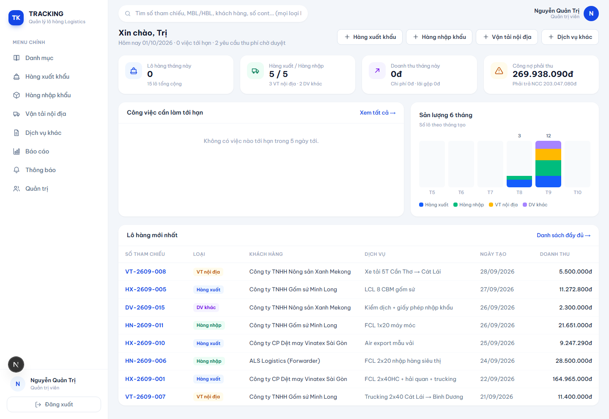
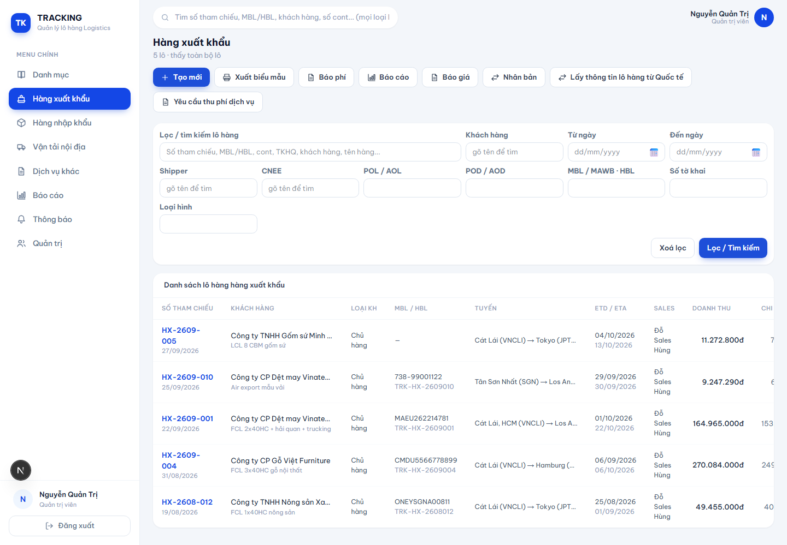
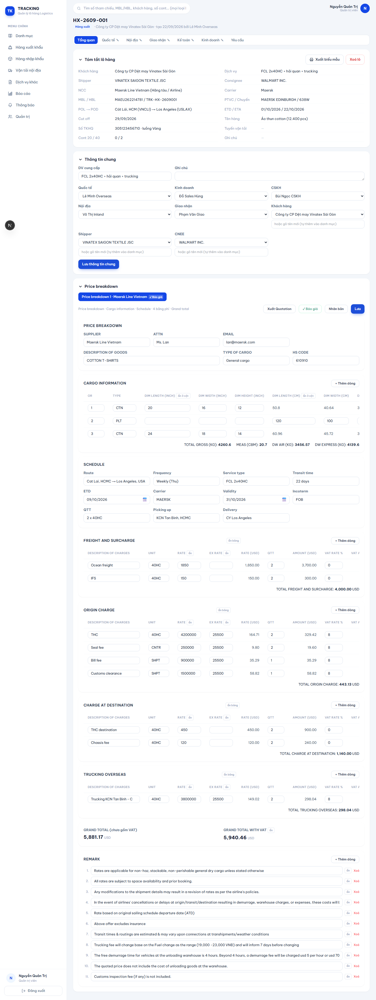
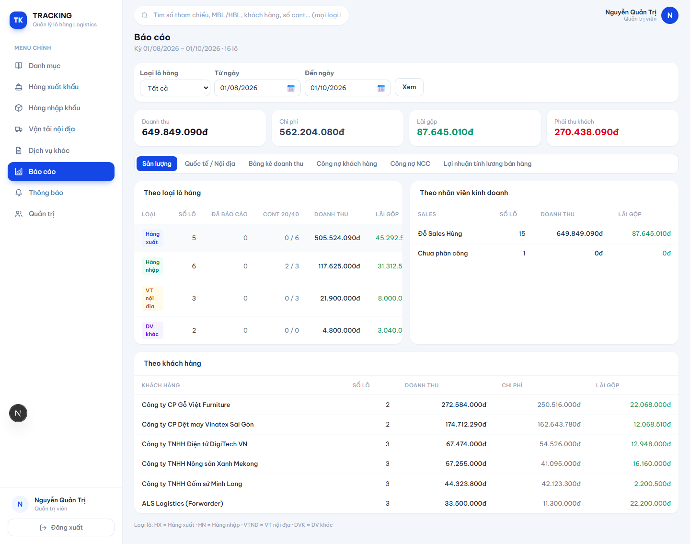
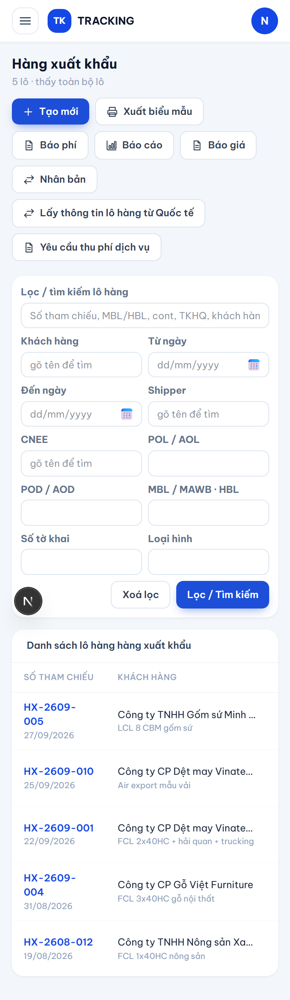
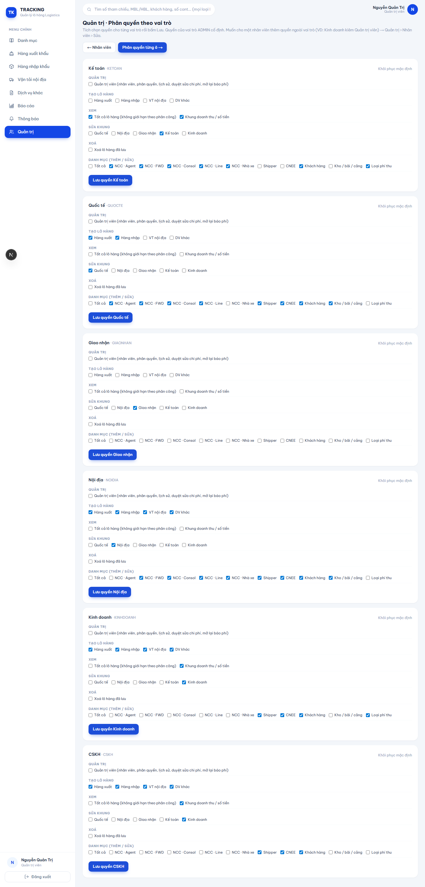
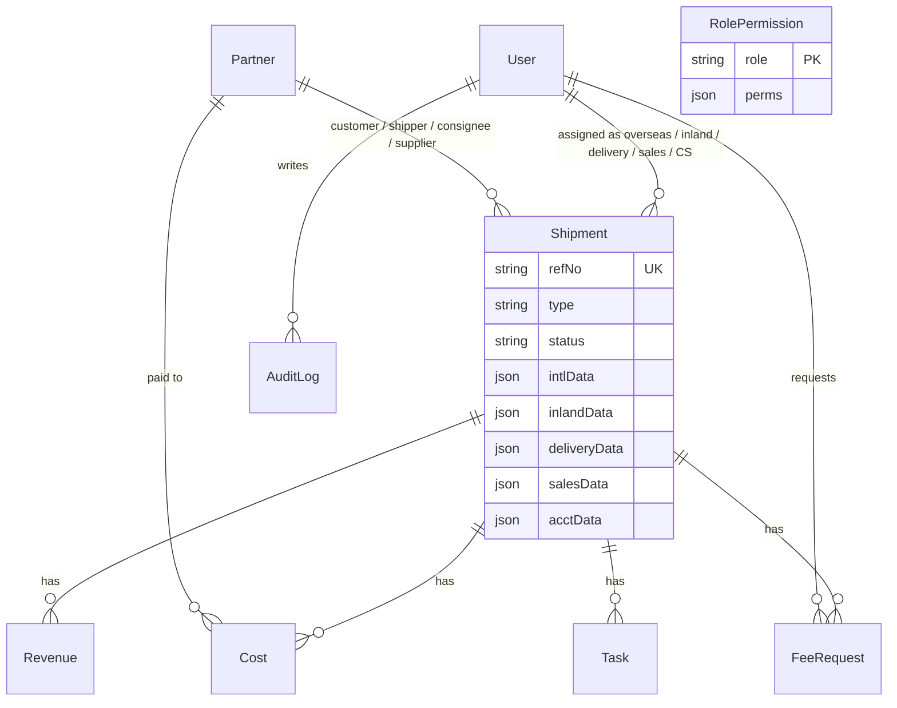

# Logistics Shipment Tracking System

Internal web app for a freight forwarding company. It replaced a set of shared spreadsheets with one system where each department works on its own part of a shipment.

> This is a case study. The source code belongs to the client and is not published here. Client name and data are removed; all screenshots use sample data.

## The problem

The company tracked every shipment in spreadsheets shared between seven departments. Anyone could overwrite anyone else's numbers, accounting had to re-type figures into reports, and documents such as the Arrival Notice were filled in by hand.

The client handed over the spreadsheet as the specification. The job was to turn it into a system with real permissions, without changing how staff already work.

## What it does

- **Four shipment types:** sea/air export, sea/air import, domestic transport, other services. Each has its own reference numbering.
- **Seven roles:** admin, accounting, international, domestic, delivery, sales, customer service. A shipment is split into sections ("frames"), and each role can edit only its own frame.
- **Money per shipment:** costs and revenue split into international and domestic scope, multi-currency with exchange rates, payments on behalf of the customer, receivables and payables.
- **Fee requests with approval:** staff submit a request, an admin approves or rejects it with a reason.
- **Reports:** volume, revenue by scope, customer receivables, supplier payables, and profit used for sales commission. One click exports a 6-sheet Excel file.
- **Documents:** quotation, Arrival Notice and Delivery Order generated as Word/Excel files in the client's own layout.
- **Audit log:** every create, edit and delete is recorded field by field ("old value → new value").
- **Small things staff asked for:** drafts saved automatically in the browser, a warning before leaving an unsaved form, and a button that copies international data into the domestic frame so nobody types it twice.

| Shipment list | Shipment detail |
|---|---|
|  |  |

| Reports | Mobile |
|---|---|
|  |  |

## Permissions

Permissions are data, not code. An admin edits them on a screen, per role and per user.

- Each role has a permission set stored in the database (create per shipment type, view scope, editable frames, delete, master-data groups).
- A user can get extra permissions on top of their role, for example a salesperson who also acts as an admin.
- By default staff see only shipments assigned to them. "See all shipments" and "see money" are separate permissions.
- Every server action checks permissions against the database on each request, so a change takes effect immediately.

## Data model

Ten models in total. The fields each department fills in differ by shipment type and change often, so each frame is stored as a JSON column described by a field definition file. Adding a field for one department is a one-line change with no migration. Money (costs, revenue, fee requests) stays in normal relational tables because it is summed and reported on.

## Stack

| Layer | Choice |
|---|---|
| Framework | Next.js 16 (App Router, Server Components, Server Actions), React 19, TypeScript |
| Database | PostgreSQL with Prisma 7 |
| Auth | Email + password (bcrypt), signed JWT session cookie (jose) |
| UI | Tailwind CSS 4, responsive down to phone width |
| Export | ExcelJS (reports, forms), docx (Word documents) |
| Hosting | Client's own Ubuntu VPS: Nginx, SSL, systemd, self-hosted PostgreSQL |

## Deployment and operations

The client wanted the system and its data on their own server.

- Build happens before upload, so the server only swaps a release folder and restarts. Releases go out outside business hours.
- One command deploys a new version; the previous release stays on disk for rollback.
- PostgreSQL is backed up every night by cron.
- A smoke-test script logs in as each role and walks through the main flows. It runs against the server after every release.

## Project facts

- Built by one developer, from the client's spreadsheet to production.
- About 7,000 lines of TypeScript across 68 files.
- Handed over for trial use in September 2026.

## Contact

Built by Leo. I am available for similar work through my Upwork profile.
